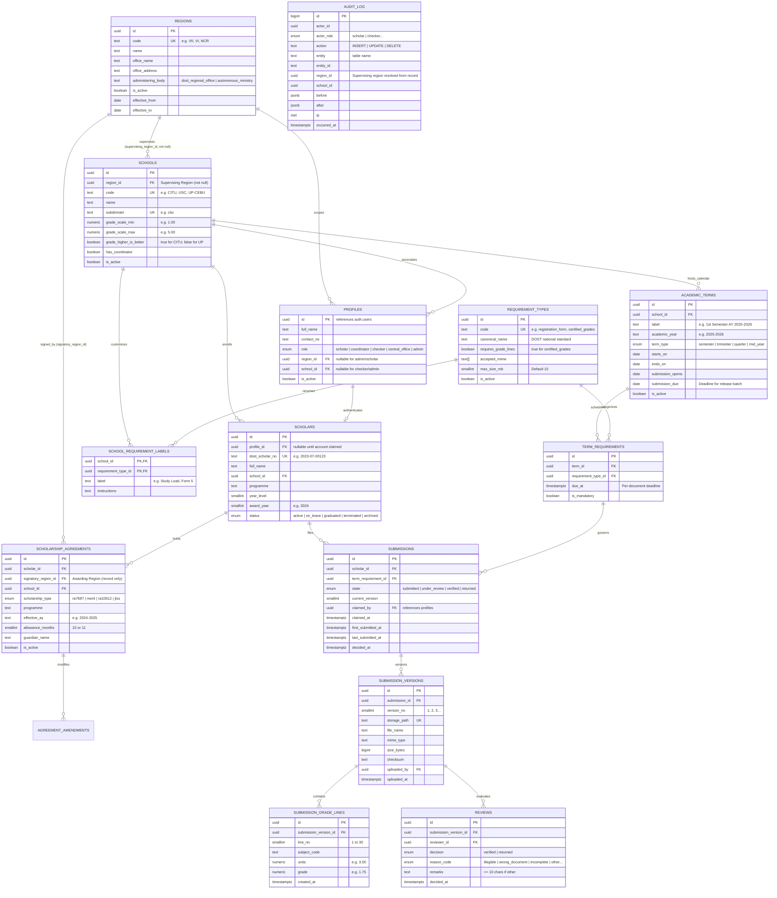

# Software Requirements Specification (SRS) & Software Design Document

## Project SEIskolar

### A Modern Platform Replacement for DOST-SEI Regional Document Submission, Compliance Tracking, and Stipend Pipeline Verification

- **Institution:** Cebu Institute of Technology – University (CIT-U)
- **Course:** Software Design
- **Project Lead & System Architect:** Adrian Seth Tabotabo
- **Team:** Asph — Adrian Seth Tabotabo, Genril Theo Soroño, Althea Maeve Kinaadman, Zedric Camilotes, Dorothy Biatriz Capao
- **Target Stakeholders:** DOST-SEI Scholars, School Coordinators, the DOST Regional Office (DOST-VII), the DOST-SEI Central Office
- **Pilot Implementation:** Cebu Institute of Technology – University under DOST Regional Office No. VII
- **Core Engineering Maxim:** _"SEIskolar provides full lifecycle transparency over scholar compliance, school tuition balance settlement, and regional-to-central stipend release pipelines."_
- **Status:** Ratified Baseline Specification
- **Document Version:** 2.2

### Revision History

| Version | Date       | Commit       | Summary                                                                                                                                                                                                                                                                                                                                                                                                                    |
| ------- | ---------- | ------------ | -------------------------------------------------------------------------------------------------------------------------------------------------------------------------------------------------------------------------------------------------------------------------------------------------------------------------------------------------------------------------------------------------------------------------- |
| 1.0     | 2026-09-05 | `17e299f`    | Initial reverse-engineered SRS and Software Design Document (PR #47): problem definition, RBAC matrix, functional requirements, system models, NFRs, prioritization, and the traceability matrix.                                                                                                                                                                                                                          |
| 2.0     | 2026-09-14 | `c150e4d`    | Scope realigned to the stipend release pipeline and school tuition balance settlement ([ADR 0013](https://github.com/dreeyanzz/seiskolar-archive/blob/23cfa313d6a4f25e0d74be4423b557c8bb56e3bf/docs/adr/0013-stipend-pipeline-and-tuition-settlement.md)): updated scope, system boundary diagram, and stakeholders table.                                                                                                 |
| 2.1     | 2026-09-25 | PR #64       | Synced to ADRs 0013 (amended), 0014 and 0015: the Central Office and system administrator roles, the six-stage release pipeline with its exits, tuition settlement, configured benefits and recorded amounts. New requirements FR-REL, FR-TUI, FR-BEN and FR-ADM; permission matrix, use cases, MoSCoW and traceability updated. The code this document was reverse-engineered from is preserved at tag `prototype-final`. |
| 2.2     | 2026-10-07 | first commit | Moved to a new repository, `dreeyanzz/seiskolar`, as `01-srs/SRS.md`. Its nine links, to ADRs 0009, 0013, 0014 and 0015, the architecture document and tag `prototype-final`, now open the archived repository `dreeyanzz/seiskolar-archive` at commit `23cfa31`. No requirement changed.                                                                                                                                  |

> A change to this document adds a row above and bumps **Document Version** in the same pull request. Record the pull request number — `main` is squash-merged, so the commit hash does not exist until the merge.

---

## 1. Introduction, Problem Definition & Scope

### 1.1 Purpose & Problem Statement

The Department of Science and Technology – Science Education Institute (DOST-SEI) manages undergraduate scholarship programs nationwide pursuant to Republic Act No. 7687 (Science and Technology Scholarship Act of 1994), Republic Act No. 10612 (Fast-Tracked S&T Scholarship Act), and the DOST-SEI Merit Scholarship Program. Beneficiaries receive crucial tuition subsidies, monthly living allowances, book/connectivity allowances, and uniform allowances. In exchange, Section VII.C of the DOST-SEI Scholarship Agreement mandates that each scholar submit a **Periodic Report** at the commencement and conclusion of every academic term:

1. An official **Registration Form / Study Load** certified by the university registrar at the beginning of the term; and
2. A **Certified Report of Grades** (True Copy of Grades) bearing the registrar's official signature and dry seal at the close of the term.

#### The Legacy Operational Reality & Root Deficiencies

In regional implementations (specifically observed within DOST Regional Office No. VII serving higher education institutions such as Cebu Institute of Technology – University), this post-award compliance cycle has historically been operated using shared Google Drive directory structures. Direct technical audits of the production Google Drive infrastructure (created June 20, 2022, holding six cohorts deep) reveal catastrophic architectural, procedural, and security failures:

1. **Catastrophic Access Control Breakdown (W1: The Link is the Credential):**
   The regional Google Drive repository was provisioned with sharing permissions configured as `type: anyone · role: writer` without requiring authentication. Any party on the public internet possessing the circulating URL—shared continuously across student cohorts via informal social messaging since 2022—can download, overwrite, alter, or permanently delete the official academic and compliance records of hundreds of government scholars without leaving a verifiable trace.
2. **Inverted Custody of State Records (W2: DOST Does Not Hold Its Own Records):**
   Individual scholar compliance folders are owned by scholars' personal `@gmail.com` accounts, and cohort batch folders are owned by private student accounts or student association officers. The DOST Regional Office—the legal supervising authority under Agreement §VIII—is merely an external guest editor on records it is statutorily mandated to preserve. If a student graduates, changes accounts, or purges personal storage, official state scholarship audit artifacts are permanently destroyed.
3. **Severe Violations of the Philippine Data Privacy Act of 2012 (Republic Act No. 10173):**
   The unauthenticated, world-writable directory tree exposes sensitive personal information (SPI) and personally identifiable information (PII), including student identification numbers, academic transcripts, failing marks, residential addresses, and parent/legal guardian identities. Under RA 10173 §25–§28, failure to implement reasonable organizational, physical, and technical security measures for government-held personal data incurs criminal liability.
4. **Severe Administrative Throughput Bottlenecks (W4 & W5: Pull Verification & Lack of Schema):**
   The directory tree enforces no file-naming syntax, directory depth constraints, or document classification. Two scholars in the same award batch file identical documents using radically discordant naming standards across five structural levels (e.g., `Yr_1 Sem_1 Grades True Copy.jpg` vs. `1ST SEM 2024-2025 GRADES.jpg`). Checkers must manually inspect folders one by one. DOST-SEI’s published service standard for _Monitoring of Scholarship Status_ specifies **one hour per scholar**. Across regional rosters containing thousands of scholars (e.g., UP Core Group deploying 4 staff against 2,000 scholars), manual folder inspection creates a multi-week administrative backlog.
5. **The Release Barrier, Opacity & Stipend Anxiety:**
   Scholars endure extreme opacity regarding financial releases. Regional evaluators set a term compliance **deadline**; after it closes, the regional office checks the reports, finalises the list of cleared scholars and sends it to the DOST-SEI Central Office, which reviews it again and releases the funds `[reported]`. In parallel, DOST sends schools tuition remittances with a proof for a list of scholars `[reported]`, which the School Coordinator credits `[reported]`; until it is credited, a scholar can be held at enrolment `[observed]`. None of these steps is visible to the scholar today. (Evidence tiers: paper §2.6.)

---

### 1.2 Scope & System Boundary

```
┌─────────────────────────────────────────────────────────────────────────────────────────────┐
│                                    SEIskolar SYSTEM BOUNDARY                                │
│                                                                                             │
│   ┌───────────────────────────────┐                  ┌──────────────────────────────────┐   │
│   │     SCHOLAR PORTAL (WEB)      │                  │       DOST REGIONAL CONSOLE      │   │
│   │  - University-branded access  │                  │  - Provision school portals      │   │
│   │  - Requirement slot dropzone  │                  │  - Dynamic term requirements     │   │
│   │  - Direct-to-storage upload   │                  │  - Claim-based review engine     │   │
│   │  - Tabular grade line editor  │                  │  - Split-screen evidence viewer  │   │
│   │  - Live weighted-average calc │                  │  - Send tuition remittances      │   │
│   │  - Stipend release pipeline   │                  │  - Release batches to Central    │   │
│   │  - Tuition balance status     │                  │  - Batch burn-down & audit logs  │   │
│   └──────────────┬────────────────┘                  └────────────────┬─────────────────┘   │
│                  │                                                    │                     │
│                  ▼                                                    ▼                     │
│   ┌───────────────────────────────┐                  ┌──────────────────────────────────┐   │
│   │      COORDINATOR WORKSPACE    │                  │    DOST CENTRAL OFFICE CONSOLE   │   │
│   │  - Custom logo & theme colors │                  │  - Approve / return batches      │   │
│   │  - School grading scale config│                  │  - Record the release            │   │
│   │  - Campus academic calendar   │                  │  - Manage benefits               │   │
│   │  - Tuition remittance verify  │                  │  - Review benefit proposals      │   │
│   │  - Credit scholar balances    │                  │                                  │   │
│   └──────────────┬────────────────┘                  └────────────────┬─────────────────┘   │
│                  │                                                    │                     │
│                  ▼                                                    ▼                     │
│   ┌─────────────────────────────────────────────────────────────────────────────────────┐   │
│   │                POSTGRES DATA CORE (RLS MULTI-TENANCY & LIFECYCLE STATE)             │   │
│   │   - Zero-trust claim authorization via Custom Access Token Hook                     │   │
│   │   - Append-only immutable versioning (v1, v2) and database transition triggers      │   │
│   │   - Private Supabase Storage bucket with strict prefix scoping                      │   │
│   └─────────────────────────────────────────────────────────────────────────────────────┘   │
└──────────────────────────────────────────────┬──────────────────────────────────────────────┘
                                               │
                                 OUT OF BOUNDARY (EXTERNAL LANES)
                                               │
                      ┌────────────────────────┴────────────────────────┐
                      ▼                                                 ▼
        ┌───────────────────────────┐                     ┌───────────────────────────┐
        │     ANNOUNCEMENTS LANE    │                     │  DIRECT BANK TRANSACTION  │
        │ DOST Scholars' Association│                     │ LandBank core banking API │
        │ peer relays & group chats │                     │ & direct wire execution   │
        │ (Retained out-of-system)  │                     │ (Tracked via milestones)  │
        └───────────────────────────┘                     └───────────────────────────┘
```

#### In Scope (System Capabilities)

- Multi-tenant scholar portal accessed via unified login, personalized per school with custom university logo and colors.
- Cryptographically enforced Row-Level Security (RLS) isolating scholars, universities, and regions.
- Account provisioning by DOST from applicant emails, with mid-award school transfer tracking.
- Pre-allocated, requirement-specific submission slots eliminating free-form file clutter.
- Direct-to-storage upload transport utilizing short-lived, presigned upload URLs (bypassing the Vercel 4.5 MB body limit).
- Tabular grade-line entry editor with live client-side and server-side Weighted Average computation:
  $$\text{Weighted Average} = \frac{\sum (\text{Units} \times \text{Grade})}{\sum \text{Units}}$$
- School Coordinator workspace for portal personalization, grading system configuration, campus academic calendar, and tuition remittance verification.
- Evaluator review workspace featuring document claiming (`under_review`), side-by-side evidence preview, and single-click verification or return with structured reason codes.
- **Stipend release pipeline** on the scholar dashboard, per release: documents outstanding → cleared → in the Regional Office's list → sent to Central Office → approved → released, with three exits (moved to a later batch, returned to the Regional Office, removed by Central Office). ADR 0013.
- **School tuition settlement**: the Regional Office sends a remittance with its proof and list of scholars; the coordinator confirms it and credits scholars one at a time or in bulk, or disputes it. ADR 0013 §2.2.
- **DOST Central Office**: approves, returns or releases batches and removes a scholar with a reason; manages benefits and reviews the Regional Office's proposals. ADR 0014, ADR 0015.
- **Recorded amounts**: a scholar sees benefit ceilings and their own release amounts exactly as DOST recorded them; the system never calculates a total. ADR 0015.
- Immutable, append-only submission versions, decision logs, and database-level audit triggers.

#### Out of Scope (Explicitly Excluded)

- **Direct Banking Execution:** SEIskolar tracks the administrative verification, remittance proofs, and disbursement milestones; it does not execute automated banking wires or LandBank core API fund transfers.
- **Scholarship Applications & Qualifying Examinations:** Pre-award onboarding remains within the national DOST-SEI e-Application portal.
- **Post-Graduation Return Service Tracking:** Employment verification and clearance under the DOST Return Service Obligation are excluded from the post-award compliance phase.
- **External Student Association Social Media:** Student association group chats operate independently; student officers have standard scholar accounts in the portal without administrative privileges.

---

### 1.3 Stakeholder Identification

| Stakeholder Role                           | Classification | Institutional Jurisdiction                   | System Authority & Access Scope                                                                                                                                                                                                   |
| :----------------------------------------- | :------------- | :------------------------------------------- | :-------------------------------------------------------------------------------------------------------------------------------------------------------------------------------------------------------------------------------- |
| **DOST Scholar**                           | Primary        | Higher Education Institution (Campus)        | Accesses personalized school portal, submits registrar files, types course grades, tracks visual stipend release progress, and views tuition balance settlement. Strictly barred from peers' records.                             |
| **School Coordinator**                     | Primary        | Campus Administration (University Employee)  | **Administers "School Stuff"**: Configures portal branding (logo, theme colors), sets unique school grading system, manages campus academic terms, verifies tuition remittance proofs, and credits student balances.              |
| **DOST Regional Office** (`checker`)       | Primary        | Supervising Regional Office (e.g., DOST-VII) | Creates schools, coordinator and scholar accounts; records transfers; sets each term's checklist and deadline; evaluates periodic reports; builds and sends release batches; sends tuition remittances; proposes benefit changes. |
| **DOST Central Office** (`central_office`) | Primary        | National (DOST-SEI Bicutan, Manila)          | Several people, each signing in. Approves, returns or releases batches and removes a scholar with a reason; manages benefits and reviews proposals; sets the §VII.A thresholds per school. Reads every region.                    |
| **System Administrator** (`admin`)         | Secondary      | The system's maintainer                      | Maintains reference data and DOST staff accounts. Makes no program decision (ADR 0014).                                                                                                                                           |
| **Supervising Regional Office**            | Secondary      | Regional Administrative Jurisdiction         | The DOST office governing the geographical location of the school (ADR-0010). Owns the RLS authorization boundary for all compliance evaluation.                                                                                  |
| **Signatory Regional Office**              | Secondary      | Awarding Regional Jurisdiction               | The DOST office of the Regional Director executing the Agreement as Party of the First Part. Maintained strictly as notarized legal provenance (`signatory_region_id`); never used for access authorization.                      |
| **State Auditors (COA)**                   | Secondary      | Commission on Audit                          | Relies on append-only `audit_log`, immutable `submission_versions`, and tuition remittance verification timestamps to audit program throughput and fund liquidation.                                                              |
| **Parent / Legal Guardian**                | External Party | Legal Co-Signer                              | Named in the scholarship agreement as solidarily liable for financial refunds under Agreement §XIII. Maintained strictly as tabular record data; **possesses zero user account or login privileges**.                             |

---

### 1.4 Architectural Trade-Off Analysis & Conflict Decisions

```
           ARCHITECTURAL TRADE-OFF ANALYSIS (ADR NEGOTIATION MATRIX)
┌─────────────────────────────────────────────────────────────────────────────────┐
│ Trade-Off 1: File Upload Pipeline Architecture (ADR-0004)                       │
│ Rejected: Next.js API Server Proxy Upload                                       │
│ Selected: Browser Direct-to-Storage via Presigned URLs                          │
│ Rationale: Vercel serverless execution limits payload bodies to 4.5 MB. Phone   │
│ scans of grades routinely reach 8–12 MB. Uploading directly to Supabase Storage │
│ ensures scalability, eliminates memory bloat, and enforces prefix security.     │
├─────────────────────────────────────────────────────────────────────────────────┤
│ Trade-Off 2: Review Queue Eligibility vs. Submission Deadlines (ADR-0011)       │
│ Rejected: Procedurally Gating Review Behind Deadline Expiration                 │
│ Selected: Immediate, Continuous Review Availability                             │
│ Rationale: Paper §2.6 identifies that post-deadline-only checking prevents     │
│ scholars from remediating errors in time. Permitting early evaluation allows   │
│ checkers to return defective files while scholars still have time to fix them.  │
├─────────────────────────────────────────────────────────────────────────────────┤
│ Trade-Off 3: Campus Nomenclature vs. National Reporting Schema (ADR-0003)       │
│ Rejected: Rigid National Requirement Names OR Unstructured School Catalogs      │
│ Selected: Canonical National Keys with School-Specific Label Overrides          │
│ Rationale: DOST monitors one national key (`registration_form`), but UP scholars│
│ look for "Form 5" and CIT-U scholars look for "Study Load / COR". Decoupling    │
│ canonical requirement codes from display labels satisfies both needs.           │
├─────────────────────────────────────────────────────────────────────────────────┤
│ Trade-Off 4: Grade Scale Harmonization vs. Institutional Autonomy (ADR-0009)    │
│ Rejected: Global Float Scale OR Hardcoded Passing Verifiers                     │
│ Selected: Per-School Scalar Bounds (`min`, `max`, `higher_is_better`)           │
│ Rationale: CIT-U evaluates on a 1.0–5.0 scale where higher is better; UP uses   │
│ 1.0–5.0 where lower is better; others use percentages (85%). The tenant school  │
│ row stores scale bounds, and Zod enforces entry limits without DB coupling.     │
└─────────────────────────────────────────────────────────────────────────────────┘
```

---

## 2. Overall System Description

### 2.1 Product Perspective

SEIskolar operates as a modern cloud-native system bridging frontend user experiences on Vercel with database-enforced security on Supabase (PostgreSQL 15).

```
┌────────────────────────────────────────────────────────────────────────────────────────┐
│                              PRESENTATION & HOSTING (VERCEL)                           │
│                                                                                        │
│   Next.js 15 Middleware (`middleware.ts`)                                              │
│   - Intercepts incoming Host headers (`citu.example.ph` vs. `dost.example.ph`)          │
│   - Rewrites host to tenant-scoped route groups (`/s/citu` vs. `/`)                    │
│   - Refreshes Supabase Auth cookies; grants ZERO data access privileges                │
│                                                                                        │
│   React Server Components (RSC) & Server Actions                                       │
│   - Fetches data directly via `@supabase/ssr` with anon key + user session cookie      │
│   - Mutations run via Server Actions validating payloads against Zod schemas           │
│   - Restricted Server Action payload limit pinned at 1 MB to prevent proxy file abuse  │
└───────────────────────────────────────────┬────────────────────────────────────────────┘
                                            │ Authenticated SQL Queries (Bearer Token)
                                            ▼
┌────────────────────────────────────────────────────────────────────────────────────────┐
│                          DATA ACCESS & STORAGE CORE (SUPABASE)                         │
│                                                                                        │
│   PostgreSQL 15 Engine (Row-Level Security Enabled on all 17 Tables)                   │
│   - Session Scope: `auth.jwt()` evaluated via helper schema `app.*`                    │
│   - Auth Hook: `public.custom_access_token_hook` injects `user_role`, `region_id`,      │
│     and `school_id` into the signed JWT upon GoTrue credential exchange                │
│   - Strict Table Grants: Default public privileges revoked (`migration 0012`);         │
│     explicit minimal verbs (`SELECT`, `INSERT`) granted per role                       │
│                                                                                        │
│   Supabase Private Storage (`submissions` bucket)                                      │
│   - Path Structure: `{region_id}/{school_id}/{scholar_id}/{term_id}/{req}/v{n}-{uuid}` │
│   - Restrictive storage policy enforces append-only immutability (UPDATE/DELETE denied)│
└────────────────────────────────────────────────────────────────────────────────────────┘
```

---

### 2.2 User Classes, Custom JWT Claims, and Permissions Matrix

#### JWT Claim Generation Architecture

To eliminate recursive query deadlocks in RLS policies (where policies query `profiles`, which in turn triggers RLS on `profiles`), SEIskolar computes session scope at sign-in via `public.custom_access_token_hook`.

```
                    SUPABASE GOTRUE AUTHENTICATION FLOW
┌─────────┐             ┌─────────────┐             ┌────────────────────────┐
│ Scholar │             │   GoTrue    │             │   Postgres Auth Hook   │
│ Browser │             │ Auth Server │             │ (public.custom_token)  │
└────┬────┘             └──────┬──────┘             └───────────┬────────────┘
     │   POST /token           │                                │
     │  (email, password)      │                                │
     │────────────────────────>│                                │
     │                         │──┐                             │
     │                         │  │ Validate credentials        │
     │                         │<─┘                             │
     │                         │                                │
     │                         │ Execute Hook (event.user_id)   │
     │                         │───────────────────────────────>│
     │                         │                                │──┐ Query `profiles`
     │                         │                                │  │ role, region_id,
     │                         │                                │<─┘ school_id
     │                         │   Inject Scope Claims          │
     │                         │<───────────────────────────────│
     │                         │   user_role, region_id,        │
     │                         │   school_id                    │
     │    Return Signed JWT    │                                │
     │<────────────────────────│                                │
```

The resulting JWT payload contains:

```json
{
  "sub": "b2f6723a-e241-419b-a010-09724128f111",
  "aud": "authenticated",
  "user_role": "scholar",
  "region_id": "77777777-7777-4000-8000-000000000007",
  "school_id": "11111111-1111-4000-8000-000000000001"
}
```

#### Detailed Role-Based Permission Matrix

| Resource Entity                        | Scholar (`scholar`)                                                                     | Coordinator (`coordinator`)                | Regional Office (`checker`)                                                      | Central Office (`central_office`)               | System Admin (`admin`)                |
| :------------------------------------- | :-------------------------------------------------------------------------------------- | :----------------------------------------- | :------------------------------------------------------------------------------- | :---------------------------------------------- | :------------------------------------ |
| `public.profiles`                      | Read own; update contact details (role/scope immutable)                                 | Read profiles within own school            | Read profiles within supervising region; create coordinator and scholar accounts | Read all                                        | Read all; create DOST staff accounts  |
| `public.scholars`                      | Read own row (`id = app.my_scholar_id()`)                                               | Read scholars enrolled in own school       | Read scholars in supervising region; record transfers                            | Read all                                        | Read all                              |
| `public.scholarship_agreements`        | Read own active agreement                                                               | Read agreements for scholars in own school | Read agreements for scholars in supervising region                               | Read all                                        | Read all                              |
| `public.submissions`                   | Read own; a new version moves `not_started` or `returned` to `submitted` (nothing else) | Read own school's                          | Read region's; claim (`under_review`), verify, return                            | Read all                                        | Read all                              |
| `public.submission_versions`           | Read own; insert version `v{n+1}`                                                       | Read own school's                          | Read region's                                                                    | Read all                                        | Read all; mutation blocked by trigger |
| `public.submission_grade_lines`        | Read own; insert lines with their version                                               | Read own school's                          | Read region's                                                                    | Read all                                        | Read all; mutation blocked by trigger |
| `public.reviews`                       | Read reviews of own versions                                                            | Read own school's                          | Read region's; insert a decision                                                 | Read all                                        | Read all; mutation blocked by trigger |
| Release batches and lines _(designed)_ | Read own line only                                                                      | —                                          | Region's: build, record amounts, send                                            | All: approve, return, remove a scholar, release | Read all                              |
| Tuition remittances _(designed)_       | Read own status only, no amount                                                         | Own school's: receive, credit, dispute     | Region's: create, correct, send                                                  | Read all                                        | Read all                              |
| Benefits _(designed)_                  | Read own benefits and their ceilings                                                    | Read                                       | Propose changes for own region (pending review)                                  | Write; review proposals                         | Read                                  |
| `public.audit_log`                     | **Access Denied (0 rows)**                                                              | **Access Denied (0 rows)**                 | Read lines whose record is in own region (ADR 0012)                              | Read all                                        | Read all                              |
| Storage: `submissions`                 | Read own files; insert to `{reg}/{sch}/{uid}/*`                                         | Read files of own school                   | Read files of supervising region                                                 | Read all                                        | Read all; update blocked              |

---

### 2.3 Operating Environment & Constraints

1. **Storage Quotas & Formatting Limits:**
   - Supported File Types: `application/pdf`, `image/jpeg`, `image/png`, `image/heic`, `image/webp`.
   - File Size Ceiling: 10 MB per individual document upload, validated at browser selection and server-side signing.
   - Upload Method: Direct HTTP `PUT` from client browser to Supabase Storage API using signed upload URLs.
2. **Network Resilience & Edge Viability:**
   - Client bundle footprint optimized for mobile bandwidth constraints (typical of state university students accessing cellular data) via React Server Component streaming.
   - Tabular grade editor debounced locally; client-side Weighted Average calculation operates entirely offline before file submission.
3. **Synthetic Data Mandate (ADR-0006):**
   - In adherence to RA 10173 and institutional ethics protocols, zero real scholar records, transcripts, or personal data may be ingested into development, staging, or demonstration environments. All development databases are seeded strictly via `supabase/seed.sql` using generated synthetic fixtures.

---

## 3. System Features & Functional Requirements (FRs)

### 3.1 Identity & Multi-Tenant Access Management

#### [FR-IAM-001] Cryptographic Session Token Scope Injection

- **Description:** The system shall inject verified tenant authorization claims into the user session token upon authentication.
- **Inputs:** User authentication credentials (email, password).
- **Validation Rules:**
  1. Profile must exist in `public.profiles` matching `auth.users.id`.
  2. Profile `is_active` flag must evaluate to `TRUE`.
  3. If profile is missing or inactive, all scope claims (`user_role`, `region_id`, `school_id`) must be stripped (`NULL`), invoking absolute deny-by-default.
- **State Transitions:** User unauthenticated $\rightarrow$ User authenticated with JWT containing claims: `user_role`, `region_id`, `school_id`.
- **Outputs:** Signed cryptographic JWT token.

#### [FR-IAM-002] Multi-Tenant Interface Host Resolution

- **Description:** Next.js middleware shall resolve incoming HTTP `Host` headers to determine the corresponding university portal layout without altering database row-level access permissions.
- **Inputs:** HTTP Request `Host` header (e.g., `citu.seiskolar.ph`, `localhost:3000`).
- **Validation Rules:**
  1. Subdomain extracted from host must not collide with system reserved keywords (`www`, `app`, `api`, `admin`, `console`, `auth`, `mail`, `static`).
  2. If a valid subdomain is identified, the request URL path shall be rewritten to `/s/[school]`.
  3. Presentation routing must never be used to verify row authorization.
- **Outputs:** Rewritten request path dispatched to App Router server components.

#### [FR-IAM-003] Cross-Tenant Row Denial

- **Description:** PostgreSQL Row-Level Security policies shall automatically filter all table queries using session claims, denying cross-tenant and cross-region record visibility.
- **Inputs:** PostgREST query dispatch from server component or action.
- **Validation Rules:**
  1. Scholar roles may only query records where `scholar_id = app.my_scholar_id()`.
  2. Regional evaluators may only query records where `app.supervising_region(scholar_id) = app.jwt_region_id()`.
  3. Queries violating scope rules must return exactly `0 rows` without throwing unhandled SQL exceptions.
- **Outputs:** Scoped result set filtered at the database engine level.

---

### 3.2 Scholar Portal & Periodic Submission Subsystem

#### [FR-SCH-001] Requirement Slot Tracking & Deadline Display

- **Description:** The scholar dashboard shall render the active academic term's requirement checklist, current completion state, and Philippine Standard Time deadline countdown banner.
- **Inputs:** Scholar authentication session, active `academic_terms` row.
- **Validation Rules:**
  1. Term deadline days remaining shall be calculated in `Asia/Manila` timezone:
     $$\text{days\_remaining} = \text{submission\_due} - (\text{now}() \text{ AT TIME ZONE } '\text{Asia/Manila}')::\text{date}$$
  2. If $\text{days\_remaining} \ge 0$ and mandatory requirements are unverified, display banner state `open_outstanding`.
  3. If $\text{days\_remaining} \ge 0$ and all mandatory requirements are verified, display banner state `open_cleared`.
  4. If $\text{days\_remaining} < 0$ and requirements remain unverified, display banner state `closed_outstanding` explicitly declaring: _"Nothing is forfeited — file now, and what you are owed is released with a later batch."_
  5. If $\text{days\_remaining} < 0$ and all requirements are verified, display `closed_cleared`.
  6. If `submission_due` is `NULL`, suppress countdown banner entirely.
- **Outputs:** Rendered dashboard with status indicators for all checklist items.

#### [FR-SCH-002] Direct-to-Storage Presigned Upload Dispatch

- **Description:** The system shall issue short-lived, cryptographically scoped presigned upload URLs allowing scholars to transfer document binaries directly to private object storage.
- **Inputs:** `termRequirementId`, `fileName`, `mimeType`, `sizeBytes`.
- **Validation Rules:**
  1. `mimeType` must belong to the permitted set (`pdf`, `jpeg`, `png`, `heic`, `webp`).
  2. `sizeBytes` must be $> 0$ and $\le 10,485,760$ bytes (10 MB).
  3. Upload path must be constructed using the strict 5-segment prefix:
     $$\{region\_id\}/\{school\_id\}/\{scholar\_id\}/\{term\_id\}/\{requirement\_code\}/\text{v}\{n\}\text{-}\{uuid\}.\{ext\}$$
     where segments `[1:3]` strictly match `app.my_document_prefix()`.
- **State Transitions:** Storage upload request initiated $\rightarrow$ Signed upload URL generated (validity $\le 300$ seconds).
- **Outputs:** JSON payload containing `{ signedUrl, storagePath }`.

#### [FR-SCH-003] Tabular Grade-Line Entry & Weighted Average Calculation

- **Description:** When submitting a requirement configured with `requires_grade_lines = TRUE` (Certified Report of Grades), the scholar shall input subject codes, units, and grades into a tabular editor that computes the running weighted average.
- **Inputs:** Array of grade lines: `[{ lineNo, subjectCode, units, grade }]`.
- **Validation Rules:**
  1. `lineNo` must be an integer between 1 and 30; duplicate line numbers are rejected.
  2. `subjectCode` must be non-empty ($2 \le \text{length} \le 20$).
  3. `units` must be positive numeric ($0 < \text{units} \le 15$).
  4. `grade` must fall within the tenant school's configured scale (`grade_scale_min` $\le \text{grade} \le$ `grade_scale_max`).
  5. Live Weighted Average must be calculated client-side and recomputed server-side:
     $$\text{WA} = \frac{\sum_{i=1}^{k} (\text{units}_i \times \text{grade}_i)}{\sum_{i=1}^{k} \text{units}_i}$$
     If total units equal 0, output `null` (preventing division-by-zero errors).
- **Outputs:** Real-time computed average rounded half-away-from-zero to 4 decimal places.

#### [FR-SCH-004] Atomic Submission Record Finalization

- **Description:** Upon successful binary upload to storage, the scholar shall commit the filing via a server action that creates an immutable version and attaches grade lines.
- **Inputs:** `termRequirementId`, `storagePath`, `fileMeta`, optional `gradeLines`.
- **Validation Rules:**
  1. Caller must have an active scholarship agreement in the school owning the requirement.
  2. Submission version record in `public.submission_versions` is append-only; update/delete actions are rejected by trigger `app.forbid_mutation()`.
  3. Grade lines are inserted into `public.submission_grade_lines` referencing the new `submission_version_id`.
  4. Database trigger `app.sync_submission_on_version_insert` automatically updates `submissions.current_version`, updates `last_submitted_at`, and transitions state to `submitted`.
- **State Transitions:** `not_started` / `returned` $\rightarrow$ `submitted`.
- **Outputs:** Confirmed submission version record.

---

### 3.3 Regional Evaluator Review Console

#### [FR-CHK-001] Evaluator Work Queue & School Filter

- **Description:** The DOST console shall display a filterable queue of submissions awaiting evaluation across institutions within the evaluator's supervising region.
- **Inputs:** Query parameters: `school` (subdomain string), `state` (enum filter), `requirement` (code string), `unchecked` (boolean flag).
- **Validation Rules:**
  1. Queue rows are queried from `public.compliance_matrix` scoped to `app.supervising_region() = app.jwt_region_id()`.
  2. Unchecked filter narrows results to scholars possessing at least one unverified submission.
  3. Display rows must surface days remaining on the term deadline without hiding overdue submissions (ADR-0011).
- **Outputs:** Ordered table of submissions sorted by `last_submitted_at` ascending.

#### [FR-CHK-002] Concurrency Control & Submission Claiming

- **Description:** An evaluator must explicitly claim a submission before executing an evaluation decision, preventing duplicate review efforts across regional staff.
- **Inputs:** `submissionId`.
- **Validation Rules:**
  1. Target submission must be in state `submitted`.
  2. Transition to `under_review` must record `claimed_by = auth.uid()` and `claimed_at = now()`.
  3. A checker may release a claim without deciding, resetting state to `submitted` with `claimed_by = NULL`.
- **State Transitions:** `submitted` $\rightarrow$ `under_review`; or `under_review` $\rightarrow$ `submitted`.
- **Outputs:** Locked submission workspace assigned to the active evaluator.

#### [FR-CHK-003] Split-Screen Verification & Grade Comparison

- **Description:** The review interface shall display an authenticated preview of the uploaded document binary alongside scholar-typed grade lines and system-computed weighted averages.
- **Inputs:** `submissionVersionId`.
- **Validation Rules:**
  1. Temporary download URL generated via Supabase Storage API (time-to-live $\le 300$ seconds).
  2. Typed grade lines rendered alongside database view summary `public.submission_grade_summary` (`total_units`, `weighted_average`, `line_count`).
- **Outputs:** Side-by-side comparative inspection pane.

#### [FR-CHK-004] Standardized Return & Approval Dispatch

- **Description:** An evaluator shall register an atomic review decision approving the document or returning it with a structured rejection code.
- **Inputs:** `submissionVersionId`, `decision` (`verified` | `returned`), `reasonCode`, optional `remarks`.
- **Validation Rules:**
  1. If `decision = 'verified'`, `reasonCode` must be `NULL`. Transition state moves to `verified` (terminal).
  2. If `decision = 'returned'`, `reasonCode` is mandatory, restricted to: `illegible`, `wrong_document`, `incomplete`, `wrong_term`, `not_certified`, `details_mismatch`, `superseded`, `other`.
  3. If `reasonCode = 'other'`, `remarks` must contain at least 10 non-whitespace characters.
  4. Reviews are append-only in `public.reviews`. Trigger `app.sync_submission_on_review_insert` updates `submissions.state`, records `decided_at`, and clears `claimed_by`.
- **State Transitions:** `under_review` $\rightarrow$ `verified`; or `under_review` $\rightarrow$ `returned`.
- **Outputs:** Updated compliance record and trigger-generated entry in `public.audit_log`.

---

### 3.4 Institutional Monitoring Subsystem

#### [FR-MON-001] Campus Batch Progress Burn-Down Aggregation

- **Description:** The system shall compute school-level clearance metrics summarizing compliance progress for active academic terms.
- **Inputs:** `school_id`, `term_id`.
- **Validation Rules:**
  1. Query executed against view `public.batch_progress` (`security_invoker = ON`).
  2. Aggregations restricted to staff roles (`app.is_staff() = TRUE`).
  3. Metrics computed:
     - Total active scholars enrolled in term (`scholars_total`).
     - Scholars cleared: count where all mandatory term requirements are in state `verified` (`scholars_cleared`).
     - Scholars outstanding: total minus cleared (`scholars_outstanding`).
     - Cells outstanding: count of unverified mandatory cells (`cells_outstanding`).
     - Oldest unsubmitted age in days relative to `term_opens_at` (`oldest_unsubmitted_days`).
- **Outputs:** Aggregate progress statistics rendered on the regional console and school coordinator views.

### 3.5 Release Pipeline, Tuition & Benefits (designed)

These requirements are decided in ADRs 0013–0015 and were not built in the prototype.
Their detailed validation rules belong to the design documents listed in the design
backlog; what is below is what the decisions already fix.

#### [FR-REL-001] Release Batch Assembly

- **Description:** The Regional Office shall build a release batch of cleared scholars for one or more benefits, record each scholar's amount per benefit, and send it to Central Office.
- **Validation Rules:**
  1. Only a scholar whose every mandatory requirement for the term is `verified` may be added.
  2. Amounts are entered by the Regional Office; the system shall not calculate them.
  3. A scholar taken off the list before sending is recorded as `removed_by_regional`.
- **State Transitions:** batch `draft` → `sent_to_central`; `returned_to_regional` → `draft`.

#### [FR-REL-002] Central Office Decision

- **Description:** Central Office shall approve or return a sent batch, remove one scholar from it with a mandatory reason, and record the release of an approved batch.
- **State Transitions:** `sent_to_central` → `approved` | `returned_to_regional`; `approved` → `released`; line `included` → `removed_by_central`.
- **Outputs:** Every transition records who made it and when.

#### [FR-REL-003] Scholar Release Status

- **Description:** A scholar shall see, for each release they are in, one status of: documents outstanding, cleared, in the Regional Office's list, sent to Central Office, approved, released, moved to a later batch, or removed by Central Office (with its reason), each with its date.
- **Validation Rules:**
  1. A scholar sees only their own line.
  2. No status predicts a date. The released status states that SEIskolar cannot see the money reach the account.
  3. Amounts shown are only those recorded on the line: requested, then released.

#### [FR-TUI-001] Tuition Remittance

- **Description:** The Regional Office shall record a remittance for one school and term: reference (check or LDDAP number), amount, proof document and list of scholars.
- **State Transitions:** `sent`; `disputed` → `sent` after correction.

#### [FR-TUI-002] Coordinator Confirmation and Crediting

- **Description:** The coordinator shall confirm a remittance matches the school's records, then credit scholars one at a time or all at once, or dispute it with a mandatory reason.
- **State Transitions:** `sent` → `received` | `disputed`; `received` → `disputed`; `received` → `settled` when every listed scholar is credited.

#### [FR-TUI-003] Scholar Tuition Card

- **Description:** A scholar on a remittance's list shall see when DOST sent their tuition and when the school credited it. The card shows no amount.

#### [FR-BEN-001] Benefit List and Rules

- **Description:** Central Office shall maintain benefits (name, ceiling, cadence, basis) and rules giving benefits to an award year and scholarship type, optionally narrowed by Agreement §VI conditions (year level or term, studying outside the home region, programme requirements).

#### [FR-BEN-002] Per-Scholar Changes and Proposals

- **Description:** Central Office shall add or remove a benefit for one scholar with a reason. The Regional Office may propose any benefit list, rule or per-scholar change; a proposal has no effect until Central Office approves it.
- **State Transitions:** proposal `pending` → `approved` | `rejected`.

#### [FR-BEN-003] Ceilings on the Scholar's Screen

- **Description:** A scholar shall see their benefits' ceilings, each labelled "payable subject to availability of funds (Agreement §VI)".

### 3.6 School & Account Administration (designed)

#### [FR-ADM-001] School and Account Provisioning

- **Description:** The Regional Office shall create schools in its region (name, code, subdomain), coordinator accounts, and scholar accounts from applicant emails with a first school. The system administrator creates DOST staff accounts only.

#### [FR-ADM-002] Transfers

- **Description:** The Regional Office shall record a transfer as an amendment of type `transfer_of_school`. The scholar's current school changes; every earlier submission keeps the school it was filed at. Which office records a move between regions is open question 26.

#### [FR-ADM-003] School Portal Settings

- **Description:** The coordinator shall set the school's portal branding (logo, primary and secondary colours), grading scale and passing grade. Central Office shall set the Agreement §VII.A threshold for each school, in that school's own scale (ADR 0009).
- **Validation Rules:** The system may show that a grade line passes and whether a term's average meets the threshold; it shall never declare standing, probation or termination.

---

## 4. System Modeling & Diagrams

### 4.1 Use Case Diagram (PlantUML)

```plantuml
@startuml
left to right direction
skinparam packageStyle rectangle
skinparam shadowing false
skinparam monochrome true

actor "DOST Scholar" as Scholar
actor "Regional Office (checker)" as Checker
actor "School Coordinator" as Coordinator
actor "Central Office" as Central
actor "System Administrator" as Admin

rectangle "SEIskolar Platform" {
  package "Authentication & Scope" {
    usecase "Authenticate Credentials" as UC_Auth
    usecase "Inject Scope Claims (JWT)" as UC_Claims
    UC_Auth .> UC_Claims : <<includes>>
  }

  package "Scholar Compliance Filing" {
    usecase "View Term Checklist & Deadline" as UC_ViewChecklist
    usecase "Request Presigned Upload URL" as UC_SignUpload
    usecase "Upload Document Binary Direct" as UC_DirectUpload
    usecase "Input Tabular Grade Lines" as UC_InputGrades
    usecase "Compute Live Weighted Average" as UC_CalcWA
    usecase "Commit Submission Version" as UC_CommitSub

    UC_InputGrades .> UC_CalcWA : <<includes>>
    UC_CommitSub .> UC_DirectUpload : <<includes>>
  }

  package "Regional Evaluation Engine" {
    usecase "Inspect Regional Review Queue" as UC_ViewQueue
    usecase "Claim Submission for Review" as UC_Claim
    usecase "Preview Split-Screen Evidence" as UC_PreviewDoc
    usecase "Verify Submission (Terminal)" as UC_Verify
    usecase "Return Submission with Reason Code" as UC_Return
    usecase "Release Claim" as UC_ReleaseClaim

    UC_Verify .> UC_PreviewDoc : <<includes>>
    UC_Return .> UC_PreviewDoc : <<includes>>
  }

  package "Release, Tuition & Benefits (designed)" {
    usecase "Build and Send Release Batch" as UC_BuildBatch
    usecase "Approve / Return / Release Batch" as UC_DecideBatch
    usecase "Remove Scholar from Batch" as UC_RemoveScholar
    usecase "View Own Release Status" as UC_ReleaseStatus
    usecase "Send Tuition Remittance" as UC_SendRemittance
    usecase "Confirm and Credit Tuition" as UC_CreditTuition
    usecase "Manage Benefits" as UC_Benefits
    usecase "Propose Benefit Change" as UC_ProposeBenefit
    UC_ProposeBenefit .> UC_Benefits : <<reviewed in>>
  }

  package "Monitoring & Administration" {
    usecase "Provision Schools and Accounts" as UC_Provision
    usecase "Record Transfer" as UC_Transfer
    usecase "Configure Branding and Grading" as UC_Portal
    usecase "Maintain Reference Data" as UC_Maintain
    usecase "View Batch Burn-Down Progress" as UC_BatchProgress
    usecase "Customize Requirement Labels" as UC_CustomLabels
    usecase "Configure Campus Terms" as UC_ConfigTerms
    usecase "Inspect Immutable Audit Logs" as UC_Audit
  }
}

Scholar --> UC_Auth
Scholar --> UC_ViewChecklist
Scholar --> UC_SignUpload
Scholar --> UC_DirectUpload
Scholar --> UC_InputGrades
Scholar --> UC_CommitSub

Checker --> UC_Auth
Checker --> UC_ViewQueue
Checker --> UC_Claim
Checker --> UC_ReleaseClaim
Checker --> UC_Verify
Checker --> UC_Return
Checker --> UC_BatchProgress
Checker --> UC_Audit

Coordinator --> UC_Auth
Coordinator --> UC_BatchProgress
Coordinator --> UC_CustomLabels
Coordinator --> UC_ConfigTerms

Scholar --> UC_ReleaseStatus
Checker --> UC_BuildBatch
Checker --> UC_SendRemittance
Checker --> UC_ProposeBenefit
Checker --> UC_Provision
Checker --> UC_Transfer
Coordinator --> UC_CreditTuition
Coordinator --> UC_Portal

Central --> UC_Auth
Central --> UC_DecideBatch
Central --> UC_RemoveScholar
Central --> UC_Benefits
Central --> UC_Audit

Admin --> UC_Auth
Admin --> UC_Maintain
@enduml
```



---

### 4.2 Submission Lifecycle State Machine Diagram (Mermaid)

```mermaid
stateDiagram-v2
    [*] --> not_started : Term checklist published

    not_started --> submitted : Scholar uploads document binary (v1) and inputs data

    submitted --> under_review : Regional Checker claims submission (records claimed_by)

    under_review --> submitted : Checker releases claim without decision (clears claimed_by)

    under_review --> verified : Checker approves document (reason_code MUST be null)

    under_review --> returned : Checker returns document (reason_code mandatory; remarks >= 10 chars if 'other')

    returned --> submitted : Scholar uploads correction (v2, v3...) via upload action

    note right of verified
        TERMINAL STATE
        Enforced by DB trigger app.enforce_submission_transition().
        No outbound transitions permitted for anyone,
        including scholars and administrators.
    end note

    note left of returned
        STRUCTURED REASON TAXONOMY:
        - illegible
        - wrong_document
        - incomplete
        - wrong_term
        - not_certified
        - details_mismatch
        - superseded
        - other (mandatory >= 10 chars)
    end note

    verified --> [*]
```



---

### 4.3 Detailed Entity-Relationship Diagram (Mermaid)

The compliance schema as the prototype built it (tag `prototype-final`), with the role list of ADR 0014. The designed release, tuition and benefit entities are in [`01-software-architecture-design.md`](https://github.com/dreeyanzz/seiskolar-archive/blob/23cfa313d6a4f25e0d74be4423b557c8bb56e3bf/docs/01-software-architecture-design.md) §2.



---

## 5. Non-Functional Requirements (NFRs) & Quality Attributes

### 5.1 Security & Data Privacy (RA 10173 Compliance)

#### [NFR-SEC-001] Strict Row-Level Security (RLS) Policy Architecture

- Every database table in `public` shall enforce RLS (`ALTER TABLE ... ENABLE ROW LEVEL SECURITY` and `FORCE ROW LEVEL SECURITY`). Tables without explicit matching policies shall deny all queries by default (`0 rows`).
- Scope verification must rely entirely on cryptographic claims read from `auth.jwt()` via helper functions (`app.jwt_role()`, `app.jwt_region_id()`, `app.jwt_school_id()`). Policies must never execute sub-select queries against `public.profiles`.

#### [NFR-SEC-002] Storage Prefix-Based Access Control

- Object storage access within the private `submissions` bucket shall be governed by PostgreSQL RLS on `storage.objects`:
  1. Scholar upload checks strictly enforce a 5-folder segment depth (`array_length(storage.foldername(name), 1) = 5`).
  2. The leading path segments `[1:3]` must identically match `app.my_document_prefix()` (`{region_id}/{school_id}/{scholar_id}`).
  3. Scholars attempting to upload files into paths belonging to other scholars, universities, or regions shall be rejected by storage RLS.
  4. Restrictive security policy `"documents are never overwritten"` shall deny all `UPDATE` actions on `storage.objects` for all authenticated and anonymous callers (`USING (false) WITH CHECK (false)`).

#### [NFR-SEC-003] Immutable, Record-Scoped Audit Logging (ADR-0012)

- All mutations (`INSERT`, `UPDATE`, `DELETE`) on compliance evidence entities shall be captured via trigger `app.write_audit()`.
- Audit log rows shall resolve their target `region_id` strictly by traversing entity relationships to the supervising school (`record -> scholar -> school -> region_id`). The system shall never fall back to the actor's session claim, ensuring administrative operations performed by national staff remain visible to regional checkers.
- Table `public.audit_log` shall enforce append-only immutability via `app.forbid_mutation()`, raising an exception on any attempt to update or delete audit records.

---

### 5.2 Performance & Latency Targets

#### [NFR-PER-001] Split-Screen Document Preview Latency

- The regional review console shall generate presigned document download URLs and render PDF/image evidence panes within **$\le 1.5$ seconds** under standard broadband connections.

#### [NFR-PER-002] Query Optimization via Pre-Computed Views

- Scholar dashboard status and regional queue queries shall resolve in a single round-trip against the pre-joined `public.compliance_matrix` and `public.batch_progress` views (`security_invoker = ON`), avoiding runtime Cartesian joins across client fetches.

#### [NFR-PER-003] Client-Side Calculation Debounce

- In-browser Weighted Average calculations in the tabular grade-line editor shall execute synchronously within **$\le 16$ milliseconds** (60 fps) of user keystrokes without initiating network requests.

---

### 5.3 Usability & Reliability

#### [NFR-REL-001] Timezone Resilience & Boundary Determinism

- All date-difference calculations, countdown banners, and batch cutoff points shall strictly execute within `Asia/Manila` (UTC+08:00). Calculations must evaluate against calendar days rather than raw UTC timestamps, preventing the 8-hour boundary error where midnight Philippine deadlines are prematurely closed in UTC.

#### [NFR-REL-002] Direct Upload Idempotency

- If a scholar experiences client disconnection during upload confirmation, re-invoking the upload workflow shall generate an incremented version UUID, ensuring orphaned storage objects never corrupt existing database versions.

#### [NFR-ACC-001] Accessible, Mobile-First Interface

- Scholar portal dropzones and status tables shall be fully functional across mobile viewports ($360\text{px}$ width minimum) and conform to WCAG 2.1 Level AA accessibility standards, including the brand guide's status colours (contrast corrected 2026-09-25), enforced in the prototype via `eslint-plugin-jsx-a11y`.

---

## 6. Prioritization & Scope Boundaries

### 6.1 MoSCoW Prioritization Matrix

```
┌────────────────────────────────────────────────────────────────────────────────────────┐
│                                   MoSCoW SCOPE MATRIX                                  │
├────────────────────────────────────────────────────────────────────────────────────────┤
│ MUST HAVE — compliance core (Phases 1–3, proven in the prototype)                      │
│  - Multi-tenant routing and JWT scope injection (ADR-0002, ADR-0010)                   │
│  - 5-segment prefix storage security and direct-to-storage uploads (ADR-0004)          │
│  - Immutable submission versions and the state machine (migration 0013)                │
│  - Tabular grade editor with live weighted average and the school's scale (ADR-0009)   │
│  - Claim -> verify / return review workflow with the 8-reason taxonomy (ADR-0005)      │
│  - Record-scoped append-only audit log (ADR-0012)                                      │
│  - Batch burn-down, 4-state deadline banner in Asia/Manila, queue filters              │
├────────────────────────────────────────────────────────────────────────────────────────┤
│ MUST HAVE — money visibility (Phase 5, designed)                                       │
│  - Release pipeline: six stages and three exits, per scholar (ADR-0013)                │
│  - Tuition settlement: sent, received, credited, disputed (ADR-0013)                   │
│  - Central Office role and console (ADR-0014)                                          │
├────────────────────────────────────────────────────────────────────────────────────────┤
│ SHOULD HAVE (Phases 4–6, designed)                                                     │
│  - Benefits configured by Central Office; recorded amounts (ADR-0015)                  │
│  - Coordinator branding, grading scale and passing grade; §VII.A thresholds (ADR-0009) │
│  - Regional Office provisioning of schools and accounts; transfers (ADR-0014)          │
│  - Deadline reminders at T-7, T-3, T-1 days (design 08)                                │
├────────────────────────────────────────────────────────────────────────────────────────┤
│ COULD HAVE                                                                             │
│  - Realtime status notifications                                                       │
│  - Server-side CSV export for the Regional Office                                      │
│  - OCR pre-fill of grade lines from certified scans                                    │
├────────────────────────────────────────────────────────────────────────────────────────┤
│ WON'T HAVE                                                                             │
│  - Executing payments, or any bank integration (milestones are recorded, not paid)     │
│  - Calculated per-scholar totals, or predicted release dates                           │
│  - Standing, probation or termination verdicts                                         │
│  - Student association announcement feeds                                              │
│  - Native iOS/Android applications                                                     │
└────────────────────────────────────────────────────────────────────────────────────────┘
```

---

### 6.2 Kano Model Categorization

```
       A Satisfied
         ▲
         │                                       / Delighters (Attractive)
         │                                      /  - Proactive "Nothing is forfeited" banner
         │                                     /   - Campus-specific vocabulary (e.g. Form 5)
         │                  Performance       /    - Live Weighted Average computation
         │                  Attributes       /
         │                     /            /
         │                    /            /
         │                   /            /
         │                  /            /
─────────┼─────────────────/────────────/────────────────────────► Implemented
         │                /            /
         │               /            /
         │              /            /
         │             /            /
         │            /
         │           /  Must-Be (Basic Expectations)
         │          /   - Zero cross-tenant data leaks (RA 10173)
         │         /    - Append-only immutable file records
         │        /     - Accurate deadline tracking (no UTC drift)
         │       /      - Evaluator document claiming (no race conditions)
         ▼
       Dissatisfied
```

---

## 7. Verification, Test Cases & Acceptance Criteria

### 7.1 Acceptance Criteria (Gherkin Format)

#### Feature: Multi-Tenant Data Isolation & Cross-Tenant Denial

_Traceability: `supabase/tests/01-cross-tenant-denial.sql`, `supabase/tests/07-supervising-region.sql`_

```gherkin
Scenario: Scholar attempts to query submissions belonging to another university
  Given an authenticated user session with role "scholar"
  And the user belongs to school "CIT-U" in region "VII"
  When the user executes a SELECT query against "public.submissions"
  Then the database engine shall return only rows where "scholar_id" matches the user's own scholar record
  And all submission rows belonging to scholars in "USC", "WVSU", or other institutions shall evaluate to zero rows

Scenario: Evaluator from Region VI attempts to inspect Region VII submissions
  Given an authenticated user session with role "checker"
  And the user holds a JWT claim "region_id" corresponding to Region "VI"
  When the evaluator queries "public.compliance_matrix" for a submission hosted at "CIT-U" (Region VII)
  Then the database engine shall return exactly 0 rows
  And the evaluator shall be denied read access to the associated document storage prefix
```

#### Feature: Submission State Machine & Write Privilege Denial

_Traceability: `supabase/tests/02-submission-state-machine.sql`, `supabase/migrations/20260830000200_submission_transitions.sql`_

```gherkin
Scenario: Scholar attempts to mark their own submission as verified
  Given an authenticated user session with role "scholar"
  And the scholar owns a submission currently in state "submitted"
  When the scholar issues an UPDATE statement setting "state = 'verified'"
  Then the PostgreSQL RLS policy "submissions_scholar_update" shall reject the modification with error code 42501
  And the submission state shall remain "submitted"

Scenario: Evaluator verifies a claimed submission without a reason code
  Given an authenticated user session with role "checker"
  And the checker has claimed a submission into state "under_review"
  When the checker inserts a row into "public.reviews" with decision "verified" and "reason_code = NULL"
  Then the database trigger "app.sync_submission_on_review_insert" shall transition the submission to "verified"
  And the submission "decided_at" timestamp shall be stamped with current time
  And the submission "claimed_by" field shall be cleared to NULL
  And subsequent attempts by anyone to transition the submission out of "verified" shall raise exception P0001
```

#### Feature: Rejection Taxonomy & Structured Reason Enforcement

_Traceability: `lib/compliance/state-machine.test.ts`, `supabase/tests/02-submission-state-machine.sql`_

```gherkin
Scenario: Evaluator returns a submission with reason 'other' but insufficient remarks
  Given an authenticated user session with role "checker"
  And the checker has claimed a submission in state "under_review"
  When the checker attempts to insert a review with:
    | decision    | returned           |
    | reason_code | other              |
    | remarks     | "Too dark"         |
  Then the check constraint "reviews_other_needs_remarks" shall reject the insertion
  And the Zod schema "reviewSchema" shall flag an invalid payload requiring at least 10 non-whitespace characters
```

#### Feature: Storage Prefix Integrity & Overwrite Prohibition

_Traceability: `supabase/tests/03-storage-prefixes.sql`, `supabase/migrations/20260830000300_storage_prefix_scope.sql`_

```gherkin
Scenario: Scholar attempts to overwrite an existing document binary
  Given an authenticated user session with role "scholar"
  And a file exists at "submissions/reg7/citu/scholar1/term1/grades/v1-uuid.pdf"
  When the scholar attempts an HTTP UPDATE / PUT replacing the existing storage object
  Then the restrictive policy "documents are never overwritten" shall deny the operation
  And the storage API shall return an unauthorized status without altering existing bytes
```

#### Feature: End-to-End Scholar Submission, Rejection, and Clearance Journey

_Traceability: `e2e/periodic-report-journey.spec.ts`_

```gherkin
Scenario: Full Periodic Report compliance loop with correction
  Given a scholar logs into the portal at "/s/usc"
  When the scholar inputs 3 grade lines totaling 9 units with Weighted Average "1.8056"
  And the scholar attaches "grades-v1.pdf" and files the requirement
  Then the submission version "v1" appears in state "Submitted"

  When an evaluator logs into "/review", claims the submission, and returns it with reason "incomplete"
  Then the scholar dashboard renders a return notice stating "Pages or subjects are missing"

  When the scholar adds a 4th subject updating units to 12 and Weighted Average to "1.6667"
  And the scholar uploads "grades-v2.pdf" as a correction
  Then submission version "v2" is recorded without overwriting "v1"

  When the evaluator re-inspects the queue, claims version "v2", and clicks "Verify"
  Then the submission transitions to "Verified"
  And the scholar checklist reflects "1 of 2 cleared" with all dropzone inputs disabled
```

---

### 7.2 Requirements Traceability Matrix (RTM)

Code and test paths in this table are the prototype's, at tag [`prototype-final`](https://github.com/dreeyanzz/seiskolar-archive/tree/prototype-final). Designed requirements trace to their ADR and to the Figma screens instead.

| Business Problem / Need                                | Requirement ID                                       | Architecture / Component Location                         | Primary Code File Implementation                                                                                                                                                                                                                                                                                        | Verification Test Suite File                                                                |
| :----------------------------------------------------- | :--------------------------------------------------- | :-------------------------------------------------------- | :---------------------------------------------------------------------------------------------------------------------------------------------------------------------------------------------------------------------------------------------------------------------------------------------------------------------- | :------------------------------------------------------------------------------------------ |
| **W1: Public Drive Links & Unauthenticated Access**    | `[FR-IAM-001]`<br/>`[FR-IAM-003]`                    | Database Core & Custom Auth Hook                          | `supabase/migrations/20260829000700_access_token_hook.sql`<br/>`supabase/migrations/20260829000800_rls_policies.sql`                                                                                                                                                                                                    | `supabase/tests/01-cross-tenant-denial.sql`<br/>`supabase/tests/04-access-token-hook.sql`   |
| **W2: Scholar Ownership & Tampering of State Records** | `[FR-SCH-002]`<br/>`[NFR-SEC-002]`                   | Supabase Private Storage & Storage RLS                    | `lib/storage/paths.ts`<br/>`supabase/migrations/20260830000300_storage_prefix_scope.sql`                                                                                                                                                                                                                                | `supabase/tests/03-storage-prefixes.sql`<br/>`lib/storage/paths.test.ts`                    |
| **W3: Opacity of Submission & Clearance Status**       | `[FR-SCH-001]`<br/>`[NFR-REL-001]`                   | Scholar UI & Philippine Timezone Engine                   | `app/(school)/s/[school]/page.tsx`<br/>`lib/compliance/deadline.ts`                                                                                                                                                                                                                                                     | `lib/compliance/deadline.test.ts`<br/>`e2e/deadline-banner.spec.ts`                         |
| **W4: Manual Folder Hunting by Checkers**              | `[FR-CHK-001]`<br/>`[FR-CHK-002]`                    | Evaluator Console Review Queue                            | `app/(root)/review/page.tsx`<br/>`app/(root)/review/actions.ts`                                                                                                                                                                                                                                                         | `e2e/evaluator-review.spec.ts`<br/>`lib/validation/queue.test.ts`                           |
| **W5: Lack of Schema & Free-Form Document Naming**     | `[FR-SCH-003]`<br/>`[FR-SCH-004]`                    | Tabular Grade Line Editor & Versions                      | `app/(school)/s/[school]/requirements/[termRequirementId]/_components/grade-line-editor.tsx`<br/>`lib/validation/submission.ts`                                                                                                                                                                                         | `supabase/tests/05-grade-lines.sql`<br/>`lib/validation/submission.test.ts`                 |
| **Mathematical Errors in Grade Spreadsheets**          | `[FR-SCH-003]`                                       | Pure Weighted Average Domain Engine                       | `lib/compliance/weighted-average.ts`<br/>`supabase/migrations/20260831000200_grade_summary_view.sql`                                                                                                                                                                                                                    | `lib/compliance/weighted-average.test.ts`<br/>`supabase/tests/06-weighted-average.sql`      |
| **Informal Chat Rejections & Loss of Reason History**  | `[FR-CHK-004]`                                       | Evaluator Review Dialog & Reason Enums                    | `app/(root)/review/[submissionId]/_components/decision-form.tsx`<br/>`lib/compliance/state-machine.ts`                                                                                                                                                                                                                  | `lib/compliance/state-machine.test.ts`<br/>`supabase/tests/02-submission-state-machine.sql` |
| **Supervising vs. Signatory Region Authority Drift**   | `[FR-IAM-003]`<br/>`[NFR-SEC-001]`                   | School-Scoped Supervision Architecture                    | `supabase/migrations/20260902000100_supervising_region.sql`<br/>`docs/adr/0010-supervision-follows-the-school.md`                                                                                                                                                                                                       | `supabase/tests/07-supervising-region.sql`<br/>`e2e/cross-region-scholar.spec.ts`           |
| **Invisible Administrative Actions in Regional Logs**  | `[NFR-SEC-003]`                                      | Record-Scoped Audit Trigger Engine                        | `supabase/migrations/20260902000300_audit_scope.sql`<br/>`docs/adr/0012-audit-scope-comes-from-the-record.md`                                                                                                                                                                                                           | `supabase/tests/08-audit-scope.sql`                                                         |
| **Batch Burn-Down Metrics for Throughput Visibility**  | `[FR-MON-001]`                                       | Security Invoker Aggregate SQL View                       | `supabase/migrations/20260903000100_batch_progress.sql`<br/>`docs/design/06-checker-queue-and-batch-progress.md`                                                                                                                                                                                                        | `supabase/tests/09-batch-progress.sql`                                                      |
| **Full Lifecycle Compliance Loop Exit Test**           | `[FR-SCH-004]`<br/>`[FR-CHK-004]`                    | Integrated End-to-End Journey                             | `app/(school)/s/[school]/requirements/actions.ts`<br/>`app/(root)/review/actions.ts`                                                                                                                                                                                                                                    | `e2e/periodic-report-journey.spec.ts`                                                       |
| **W3: No sight of the stipend after checking**         | `[FR-REL-001]`<br/>`[FR-REL-002]`<br/>`[FR-REL-003]` | Release pipeline (designed)                               | [ADR 0013](https://github.com/dreeyanzz/seiskolar-archive/blob/23cfa313d6a4f25e0d74be4423b557c8bb56e3bf/docs/adr/0013-stipend-pipeline-and-tuition-settlement.md), [ADR 0014](https://github.com/dreeyanzz/seiskolar-archive/blob/23cfa313d6a4f25e0d74be4423b557c8bb56e3bf/docs/adr/0014-roles-and-who-records-what.md) | Design test matrix (pending design document)                                                |
| **W3: No sight of tuition settlement**                 | `[FR-TUI-001]`<br/>`[FR-TUI-002]`<br/>`[FR-TUI-003]` | Tuition settlement (designed)                             | [ADR 0013](https://github.com/dreeyanzz/seiskolar-archive/blob/23cfa313d6a4f25e0d74be4423b557c8bb56e3bf/docs/adr/0013-stipend-pipeline-and-tuition-settlement.md) §2.2                                                                                                                                                  | Design test matrix (pending design document)                                                |
| **Benefits hardcoded; amounts that read as promises**  | `[FR-BEN-001]`<br/>`[FR-BEN-002]`<br/>`[FR-BEN-003]` | Benefit administration (designed)                         | [ADR 0015](https://github.com/dreeyanzz/seiskolar-archive/blob/23cfa313d6a4f25e0d74be4423b557c8bb56e3bf/docs/adr/0015-benefits-are-configured-by-central-office.md)                                                                                                                                                     | Design test matrix (pending design document)                                                |
| **School and account administration**                  | `[FR-ADM-001]`<br/>`[FR-ADM-002]`<br/>`[FR-ADM-003]` | Regional Office and coordinator administration (designed) | [ADR 0014](https://github.com/dreeyanzz/seiskolar-archive/blob/23cfa313d6a4f25e0d74be4423b557c8bb56e3bf/docs/adr/0014-roles-and-who-records-what.md), [ADR 0009](https://github.com/dreeyanzz/seiskolar-archive/blob/23cfa313d6a4f25e0d74be4423b557c8bb56e3bf/docs/adr/0009-per-school-grade-scale.md)                  | Design test matrix (pending design document)                                                |

---

## Conclusion & Architectural Sign-Off

This Software Requirements Specification and Software Design Document began (v1.0) by reverse-engineering the SEIskolar prototype, now preserved at tag `prototype-final`, into a formal requirements framework. Since v2.1 it also specifies the designed release, tuition, benefit and administration requirements decided in ADRs 0013–0015, which the prototype never built. By grounding all functional behaviors, cryptographic boundaries, and state machines directly in the repository code, database migrations, and Architecture Decision Records (ADRs), the platform establishes a defensible, production-ready compliance management system that eliminates the severe security and throughput vulnerabilities of legacy shared drives.
