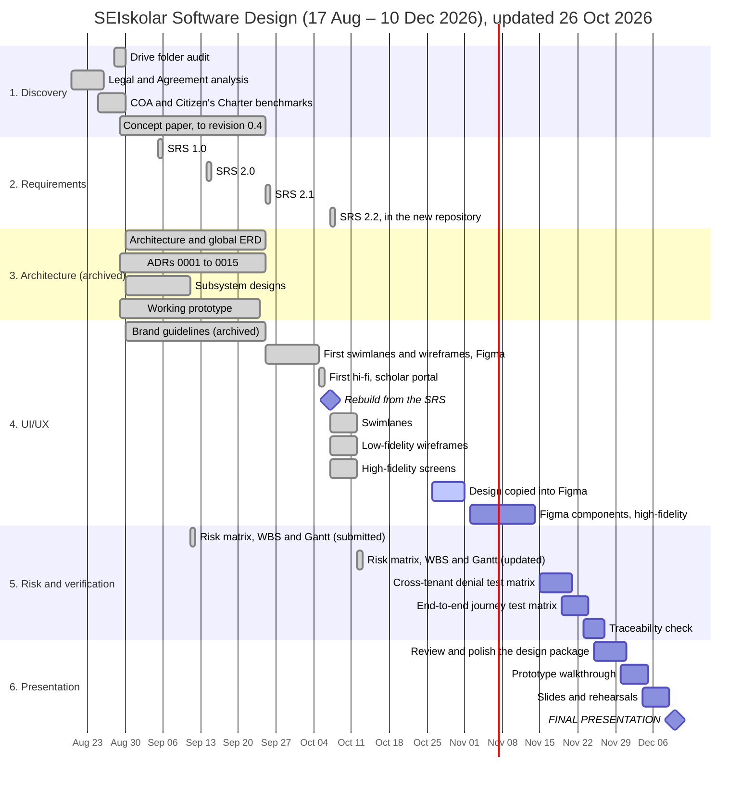

# Project SEIskolar: Software Design Deliverable Package

**Risk matrix, work breakdown structure and Gantt chart, updated on 12 October 2026, and
for Figma on 26 October 2026**

**Group name:** Asph  
**Team members:** Adrian Seth Tabotabo (Project Manager) · Genril Theo Soroño · Althea Maeve
Kinaadman · Zedric Camilotes · Dorothy Biatriz Capao  
**Institution and course:** Cebu Institute of Technology – University (CIT-U) | Software
Design  
**Project:** SEIskolar, the software design of a system for DOST-SEI undergraduate scholars:
filing the per-term Periodic Report, checking it, and seeing where each scholar's stipend
and tuition stand  
**Timeline:** 17 August 2026 to 10 December 2026, the final presentation  
**Scope:** design only. Requirements, swimlanes, wireframes and finished screens; nothing is
implemented (AGENTS.md, "There is no code here").

> **This is the updated version.** The team submitted the first version of this package for
> the course on 11 September 2026. That version is unchanged in the archived repository:
> [the Markdown document](https://github.com/dreeyanzz/seiskolar-archive/blob/23cfa313d6a4f25e0d74be4423b557c8bb56e3bf/docs/05-software-design-risk-matrix-and-gantt.md)
> and [the submitted .docx](https://github.com/dreeyanzz/seiskolar-archive/blob/23cfa313d6a4f25e0d74be4423b557c8bb56e3bf/docs/SEIskolar_Software_Design_and_Risk_Matrix.docx).
> On 12 October 2026 Adrian asked for the package to come back into this repository,
> updated for the rebuild of 7 October. What changed, and why:
>
> - **The repository.** On 7 October 2026 the design moved to this repository, which holds
>   only the SRS and the drawings built from it. The rest of the earlier design work (the
>   concept paper, the architecture, the ADRs, the subsystem designs, the design protocol
>   and the brand guidelines) stays in the archived repository,
>   `dreeyanzz/seiskolar-archive`. Part 1's list of artifacts is rewritten for this.
> - **The schedule.** Part 3 now shows what was done and when, with dates taken from both
>   repositories' git history and from the SRS's revision history, and keeps the submitted
>   plan for what is still ahead. Most of the design work happened earlier than planned.
> - **The risks.** Seven of the nine risks stand as the team rated them in September, with
>   mitigations that now point at what this repository holds. Two no longer apply and are
>   replaced: T2 (a local database drifting from the cloud one: there is no database any
>   more) and E1 (the overhead of the four-artifact design protocol, which this repository
>   does not use). **The new T2 and E1, and their ratings, are proposals for the team to
>   confirm.**
> - **The grid.** Two cells of the submitted 5×5 grid were in the wrong zone for its own
>   legend: likelihood 5 with impact 3 scores 15, which is red, not yellow; likelihood 3
>   with impact 2 scores 6, which is green, not yellow. Both are corrected.
> - **The team.** Asph has five members. The submitted version listed four, and spelled
>   Dorothy Biatriz Capao's name as "Beatriz Capao".
> - **Figma (26 October 2026).** Adrian settled the question risk T2 turned on: the course
>   needs the design in Figma, as editable layers. The design is copied into a new Figma
>   file by tools in this repository, `tools/figma/`, and the earlier file is labelled as
>   the earlier design. T2's mitigation, WBS tasks 4.9 and 4.10, the Gantt chart and
>   "Still open" say so.

---

## Part 1: Preliminary research and artifacts inventory

The team researched the problem before designing, rather than assuming it. The research
is unchanged since September; only where each finding is written down has moved.

### 1. Empirical field research and technical folder audit

- **CIT-U DOST-VII live Google Drive audit, 28 and 30 August 2026.**
  - _Where it is written down:_ the SRS, §1.1, in this repository
    ([`01-srs/SRS.md`](../01-srs/SRS.md)), and the concept paper, §2.5, in the archive
    ([`docs/00-concept-paper.md`](https://github.com/dreeyanzz/seiskolar-archive/blob/23cfa313d6a4f25e0d74be4423b557c8bb56e3bf/docs/00-concept-paper.md)).
  - _Primary evidence:_ a direct audit of the production Google Drive folder, created on
    20 June 2022 and holding six cohorts of scholars.
  - _Findings:_
    1. **W1, the link is the credential.** Sharing was set to `type: anyone · role:
writer`, with no sign-in: anyone on the internet with the link could read or change
       scholars' records.
    2. **W2, inverted custody.** Scholars' folders were owned by their personal
       `@gmail.com` accounts. The DOST Regional Office, which supervises the records, was
       only a guest editor.
    3. **W3, no status.** Nothing showed whether a filed document had been verified or
       returned.
    4. **W4, pull verification.** Checkers opened folders one by one, with no work queue
       and no way to see what had changed.
    5. **W5, no structure.** Two scholars in the same batch named the same documents in
       five different ways, across five folder levels.

### 2. Legal, statutory and regulatory framework

- **Laws:**
  - Republic Act No. 7687, the Science and Technology Scholarship Act of 1994.
  - Republic Act No. 10612, the Fast-Tracked S&T Scholarship Act.
  - Republic Act No. 10173, the Data Privacy Act of 2012: the security of sensitive
    personal information such as grades and guardians' details.
- **The DOST-SEI Scholarship Agreement**, the 2024 notarised contract, analysed in the
  concept paper's §10 and its reference 1 (archive):
  - §VI: the financial assistance, and its auditing limits.
  - §VII.A and §VII.C: the Periodic Report (the Study Load at the start of a term and the
    Certified True Copy of Grades at its end) and the grade requirements.
  - §VIII and §IX: supervision by the Regional Office against disbursement by the Central
    Office in Manila, and termination after two consecutive terms of non-compliance.
  - §XIII and §XIV: the parent or guardian's liability for refunds, and the limits of the
    data privacy consent.

### 3. State audits and service benchmarks

Written down in the concept paper, §2.4, with its sources in its §11 references (archive):

- **Commission on Audit findings, December 2024** (references 4 and 5): DOST-SEI flagged
  for about ₱1.75 billion in fund transfers to universities still unaccounted for (only
  16.40% of the ₱642.109 million transferred in 2023 was liquidated), and stipend delays
  of 1 to 12 months, recurring since 2015.
- **DOST-SEI Citizen's Charter 2025** (reference 2): the published service standard for
  Monitoring of Scholarship Status is **one hour per scholar**. UP's core group ran four
  staff against 2,000 scholars (reference 6), so a queue takes weeks.

### 4. Design artifacts

**In this repository**, `dreeyanzz/seiskolar`. Each is built only from the one before it,
except this package, which plans the work:

| Artifact                                | Path                                        | What it holds                                                                                                                                                                                                                                                           |
| :-------------------------------------- | :------------------------------------------ | :---------------------------------------------------------------------------------------------------------------------------------------------------------------------------------------------------------------------------------------------------------------------- |
| **Software Requirements Specification** | [`01-srs/SRS.md`](../01-srs/SRS.md)         | Version 2.2. Problem, scope and stakeholders; the permission matrix; 24 functional requirements (FR-IAM, FR-SCH, FR-CHK, FR-MON, FR-REL, FR-TUI, FR-BEN, FR-ADM); use cases, the state machine and the ERD; NFRs; MoSCoW; acceptance criteria; the traceability matrix. |
| **Swimlanes**                           | [`02-swimlanes/`](../02-swimlanes/)         | 10 workflows with 107 numbered steps (`S01.1` …), covering all 24 functional requirements.                                                                                                                                                                              |
| **Low-fidelity wireframes**             | [`03-low-fidelity/`](../03-low-fidelity/)   | 29 screens with 42 states, each drawn for a phone, a tablet and a desktop, each citing the swimlane steps it serves.                                                                                                                                                    |
| **High-fidelity screens**               | [`04-high-fidelity/`](../04-high-fidelity/) | The 29 screens finished, as one clickable prototype that meets WCAG 2.1 AA, in the school's colours inside its portal.                                                                                                                                                  |
| **This package**                        | [`05-risk-matrix-and-gantt/`](./)           | The risk matrix, the work breakdown structure and the Gantt chart.                                                                                                                                                                                                      |
| **The design in Figma**                 | [`tools/figma/`](../tools/figma/README.md)  | The tools that copy every swimlane, wireframe and screen into the Figma file [SEIskolar – current design (Asph)](https://www.figma.com/design/fsEKjSfF5mPRh5NIwwuign) as editable layers, one frame per PNG. The repository stays the source.                           |
| **Guide for AI agents and members**     | [`AGENTS.md`](../AGENTS.md)                 | How the repository is worked on: the rules of the chain, writing everything in full, git and pull requests.                                                                                                                                                             |

**Earlier design work, in the archive**, `dreeyanzz/seiskolar-archive`, as it stood on
5 October 2026 (commit `23cfa31`):

| Artifact                                  | Path                                                                                                                                                                                                                                                            | What it holds                                                                                                                                                                                       |
| :---------------------------------------- | :-------------------------------------------------------------------------------------------------------------------------------------------------------------------------------------------------------------------------------------------------------------- | :-------------------------------------------------------------------------------------------------------------------------------------------------------------------------------------------------- |
| **Concept paper**, revision 0.4           | [`docs/00-concept-paper.md`](https://github.com/dreeyanzz/seiskolar-archive/blob/23cfa313d6a4f25e0d74be4423b557c8bb56e3bf/docs/00-concept-paper.md)                                                                                                             | The problem, the five weaknesses, the evidence (marked reported or observed), scope, and the Agreement.                                                                                             |
| **Architecture and detailed design**      | [`docs/01-software-architecture-design.md`](https://github.com/dreeyanzz/seiskolar-archive/blob/23cfa313d6a4f25e0d74be4423b557c8bb56e3bf/docs/01-software-architecture-design.md)                                                                               | The C4 container view, the full ERD with the release, tuition and benefit tables, the auth and upload flows, and the component structure.                                                           |
| **Software design protocol**              | [`docs/03-software-design-protocol.md`](https://github.com/dreeyanzz/seiskolar-archive/blob/23cfa313d6a4f25e0d74be4423b557c8bb56e3bf/docs/03-software-design-protocol.md)                                                                                       | The four artifacts each feature's design needed: sequence flow, state contracts, components, and a security and test matrix.                                                                        |
| **Architecture Decision Records**         | [`docs/adr/`](https://github.com/dreeyanzz/seiskolar-archive/tree/23cfa313d6a4f25e0d74be4423b557c8bb56e3bf/docs/adr)                                                                                                                                            | ADRs 0001 to 0017: each decision, and the alternatives it rejected.                                                                                                                                 |
| **Subsystem designs**                     | [`docs/design/`](https://github.com/dreeyanzz/seiskolar-archive/tree/23cfa313d6a4f25e0d74be4423b557c8bb56e3bf/docs/design)                                                                                                                                      | Nine designs: tenancy and auth, submission, the RLS model, storage, the audit log, the checker queue, the admin console, scheduled work, and supervising against signatory regions.                 |
| **Brand guidelines**                      | [`docs/02-brand-guidelines.md`](https://github.com/dreeyanzz/seiskolar-archive/blob/23cfa313d6a4f25e0d74be4423b557c8bb56e3bf/docs/02-brand-guidelines.md)                                                                                                       | Colour tokens, typography and accessibility rules. The screens in `04-high-fidelity/` use their own palette, which also meets WCAG 2.1 AA.                                                          |
| **Open questions and postmortems**        | [`docs/OPEN-QUESTIONS.md`](https://github.com/dreeyanzz/seiskolar-archive/blob/23cfa313d6a4f25e0d74be4423b557c8bb56e3bf/docs/OPEN-QUESTIONS.md), [`notes/`](https://github.com/dreeyanzz/seiskolar-archive/tree/23cfa313d6a4f25e0d74be4423b557c8bb56e3bf/notes) | The stakeholder questions, including number 26, which the SRS cites; nine postmortems.                                                                                                              |
| **The working prototype**                 | [tag `prototype-final`](https://github.com/dreeyanzz/seiskolar-archive/tree/prototype-final)                                                                                                                                                                    | Built from 29 August to 24 September 2026 to test the design, then removed from the design repository on 25 September.                                                                              |
| **First swimlanes, wireframes and hi-fi** | [`docs/FIGMA.md`](https://github.com/dreeyanzz/seiskolar-archive/blob/23cfa313d6a4f25e0d74be4423b557c8bb56e3bf/docs/FIGMA.md), [`docs/hifi/`](https://github.com/dreeyanzz/seiskolar-archive/tree/23cfa313d6a4f25e0d74be4423b557c8bb56e3bf/docs/hifi)           | The first swimlanes and wireframes, drawn in Figma, and a first scholar-portal prototype. Replaced on 7 October by `02-swimlanes/` to `04-high-fidelity/`; the Figma file still holds its drawings. |

---

## Part 2: Project risk matrix (per the `Risk_Matrix.docx` rubric)

### Step 1: Identified project risks (9 risks across 5 categories)

1. **Technology risks:**
   - `Risk T1 (Storage payload limit):` photos and scans of grade sheets taken on phones
     reach 8 to 12 MB, more than a serverless request accepts (for example Vercel's 4.5
     MB body limit), so uploads would fail.
   - `Risk T2 (Design copies drift apart), new:` this repository holds the current
     swimlanes, wireframes and screens, while the Figma file still holds the earlier ones.
     Anyone who opens Figma, a reviewer or a teammate, sees designs the team no longer
     presents. This is already the case on 12 October 2026. On 26 October 2026 the course
     was found to need the design in Figma, so the copy must be current, not only labelled
     (Step 4 says how).
   - `Risk T3 (Cross-tenant data leakage):` a flaw in row-level security lets a scholar or
     another school's or region's staff see or change records that are not theirs.
2. **People and process risks:**
   - `Risk P1 (Design drift across the team):` several members, and the AI agents they work
     through, change the design at once, so names, states and rules stop agreeing across
     the SRS, the swimlanes and the screens.
3. **Organisational and legal risks:**
   - `Risk O1 (Data Privacy Act violation):` real scholars' personal information, failing
     grades or guardians' details end up in design documents or prototypes without a data
     sharing agreement with DOST-SEI (RA 10173).
   - `Risk O2 (Procedural resistance):` Regional Office checkers keep checking only after the
     deadline, out of habit, and do not use the early, continuous checking the design
     allows.
4. **Requirements risks:**
   - `Risk R1 (Incompatible grading scales):` schools grade in opposite directions (CIT-U
     uses 1.00 to 5.00 with 5.00 the best; UP uses 1.00 to 5.00 with 1.00 the best), so one
     national threshold would flag good students as failing.
   - `Risk R2 (Scope creep into disbursement):` stakeholders expect SEIskolar to move
     money: LandBank transactions, cheques or disbursement vouchers.
5. **Estimation risks:**
   - `Risk E1 (Drawing and documentation overhead), new:` every screen is drawn in two
     fidelities and for three devices, and every change is written up in full for the next
     agent (AGENTS.md, "Write everything in full"). This takes longer than quick sketches,
     and can squeeze the time left before the presentation.

Risks retired in this update, and why:

- The submitted **T2**, a local database drifting from the cloud one, applied to the
  prototype. The project has had no database since the prototype was removed on
  25 September 2026.
- The submitted **E1**, the overhead of the four-artifact design protocol, applied to the
  protocol in the archive, which this repository does not use.

---

### Step 2: Rate each risk (likelihood and impact, 1 to 5)

| Risk ID  | Category           | Risk                                                            | Likelihood ($L$) |     Impact ($I$)     | Score ($L \times I$) |    Zone    |
| :------: | :----------------- | :-------------------------------------------------------------- | :--------------: | :------------------: | :------------------: | :--------: |
| **`O1`** | **Organisational** | **Data Privacy Act violation with real scholars' data**         |  **4 (Likely)**  | **5 (Catastrophic)** |        **20**        |  **Red**   |
| **`T1`** | **Technology**     | **Upload failure on large phone scans**                         |  **4 (Likely)**  |   **4 (Serious)**    |        **16**        |  **Red**   |
| **`R1`** | **Requirements**   | **Incompatible grading scales and false failing flags**         |  **4 (Likely)**  |   **4 (Serious)**    |        **16**        |  **Red**   |
| **`T3`** | **Technology**     | **Cross-tenant data leakage through row-level security**        | **3 (Moderate)** | **5 (Catastrophic)** |        **15**        |  **Red**   |
|   `R2`   | Requirements       | Scope creep into disbursement and banking                       |   3 (Moderate)   |     4 (Serious)      |          12          |   Yellow   |
|   `O2`   | Organisational     | Procedural resistance to checking before the deadline           |    4 (Likely)    |     3 (Moderate)     |          12          |   Yellow   |
|   `T2`   | Technology         | Design copies drift apart: repository and Figma (new, proposed) |    4 (Likely)    |     3 (Moderate)     |          12          |   Yellow   |
| **`P1`** | **People/Process** | **Design drift across the team and their AI agents**            | **3 (Moderate)** |   **3 (Moderate)**   |        **9**         | **Yellow** |
|   `E1`   | Estimation         | Drawing and documentation overhead (new, proposed)              |   3 (Moderate)   |     3 (Moderate)     |          9           |   Yellow   |

The new T2 is rated likely because it is already true, and moderate because it misleads
rather than breaks anything. The new E1 keeps the rating of the risk it replaces, which
described the same kind of overhead.

---

### Step 3: 5×5 risk matrix grid

```
Impact (I)
  ▲
5 │ Catastrophic │ [ Green ]      [ Yellow ]      [ T3 ]          [ O1 ]          [ Red ]
4 │ Serious      │ [ Green ]      [ Yellow ]      [ R2 ]          [ T1, R1 ]      [ Red ]
3 │ Moderate     │ [ Green ]      [ Green ]       [ P1, E1 ]      [ O2, T2 ]      [ Red ]
2 │ Minor        │ [ Green ]      [ Green ]       [ Green ]       [ Yellow ]      [ Yellow ]
1 │ Minimal      │ [ Green ]      [ Green ]       [ Green ]       [ Green ]       [ Green ]
  └──────────────┴──────────────────────────────────────────────────────────────────────────►
                        1               2               3               4               5
                   Very unlikely    Unlikely        Moderate         Likely        Very likely
                                                Likelihood (L)

LEGEND:
■ RED ZONE (score 15 to 25): critical. Needs an immediate, written mitigation plan.
■ YELLOW ZONE (score 8 to 14): moderate. Watched closely, with standard controls.
■ GREEN ZONE (score 1 to 7): low. Handled by routine practice.
```

Every empty cell is labelled with the zone its score falls in by the legend. In the
submitted grid, likelihood 5 with impact 3 (score 15) and likelihood 3 with impact 2
(score 6) were both labelled yellow; they are red and green.

---

### Step 4: Prioritise the risks and choose the top 3

The top three are unchanged from the submitted version:

1. **Top risk 1: `O1` (organisational and legal):** a Data Privacy Act violation with real
   scholars' data ($L=4, I=5$, score 20, red).
2. **Top risk 2: `T3` (technology and security):** cross-tenant data leakage through
   row-level security ($L=3, I=5$, score 15, red).
3. **Top risk 3: `P1` (people and process):** design drift across the team and their AI
   agents ($L=3, I=3$, score 9, yellow).

Why some higher-scoring risks are not in the top three:

- **T1 and R1 (16 each)** were resolved by the design itself. T1: files go straight to
  private storage through a short-lived link, never through the server, up to 10 MB
  (SRS FR-SCH-002; swimlane 03, step S03.8). R1: each school sets its own grading scale
  and passing grade, and Central Office sets each school's threshold in that school's own
  scale (SRS FR-ADM-003; swimlane 09).
- **R2 (12)** is held by the SRS's scope: banking transactions are out of scope (SRS §1.2),
  and the release status tells the scholar that SEIskolar cannot see the money reach the
  account (FR-REL-003).
- **O2 (12)** depends on the Regional Office's practice, which the team does not control.
  The design already allows early checking: the queue never waits for the deadline
  (FR-CHK-001).
- **T2 (12)** turned on one question, whether the course needs the designs in Figma.
  Adrian settled it on 26 October 2026: it does, as editable layers. The mitigation is
  in two parts. First, the design is copied into a new file,
  [SEIskolar – current design (Asph)](https://www.figma.com/design/fsEKjSfF5mPRh5NIwwuign),
  by tools rather than by hand ([`tools/figma/`](../tools/figma/README.md)): every frame
  is drawn from its HTML and named as its PNG, so a copy that disagrees with the
  repository can be redrawn with one command. Second, the earlier file, "Asph –
  SEIskolar", gets a banner on every page saying it is the earlier design and where the
  current one is. T2 stays open until both are done (WBS 4.9).

---

### Step 5: Mitigation plans for the top 3 risks

#### Top risk 1: `O1`, a Data Privacy Act violation with real scholars' data

- **Avoidance:** the rule "Invented people only" (AGENTS.md, "The rules of the chain"):
  invented names, `@example.test` addresses, scholar numbers that are plainly fake, and
  never a teammate's name on a persona. It continues ADR 0006 (archive).
- **Minimisation:** every drawing uses the same invented cast and invented schools, except
  CIT-U, the pilot school; amounts and dates are sample values. The pull request template
  asks the author to confirm "Invented people only", and reviewers check it.
- **Contingency:** if real data is found, it is removed in a pull request at once and
  Adrian is told. Removing it from git history as well needs a force-push, which the
  "main: core integrity" ruleset forbids for everyone
  ([`.github/rulesets/README.md`](../.github/rulesets/README.md)); Adrian would lift the
  rule, purge the history, and restore the rule.

#### Top risk 2: `T3`, cross-tenant data leakage through row-level security

- **Avoidance:** the SRS takes every scope decision from the signed session token, never
  from the address (FR-IAM-001, FR-IAM-002), and a record outside a person's scope comes
  back as zero rows, never an error (FR-IAM-003, NFR-SEC-001).
- **Minimisation:** the design draws the wrong person's view, not only the right one:
  swimlane 01, steps S01.10 to S01.12, where a record outside the session's scope returns
  nothing; the "Nothing to show" screen (`nothing-found`); and swimlane 10, where a
  scholar or coordinator who opens a record's history gets no rows (S10.6, S10.8). The
  prototype tested this model with a policy test suite that talked to the database
  directly; it is preserved at tag `prototype-final` in the archive.
- **Contingency:** a swimlane or screen that shows one school's or one region's data to
  another is a blocking finding in review, fixed before the pull request merges
  (AGENTS.md, "Reviewing a pull request").

#### Top risk 3: `P1`, design drift across the team and their AI agents

- **Avoidance:** the chain. Each deliverable is built only from the one before it; every
  swimlane step is numbered; every wireframe names the steps it serves; every
  high-fidelity screen has its wireframe's name and a comment with its context. The SRS
  changes only when Adrian says so, with a new revision row (AGENTS.md, "The rules of the
  chain" and "Git and pull requests").
- **Minimisation:** every agent reads AGENTS.md first, and everything is written in full,
  so decisions and their reasons are in the repository rather than in a chat (AGENTS.md,
  "Write everything in full"). Every change is a pull request with one approval, and the
  checks on it verify formatting, that every drawing has its pictures, and the title,
  branch and body.
- **Contingency:** if the drawings disagree with each other or with the SRS, the step
  numbers and the folder indexes show where, and the correction is one pull request that
  updates every file the change affects. When drift became too much in the old
  repository, where members' agents got lost among documents about a deleted prototype,
  the team rebuilt the repository from the SRS on 7 October 2026.

---

## Part 3: Work breakdown structure (WBS) and Gantt chart

**Project schedule:** 17 August 2026 to 10 December 2026 (17 weeks, design only).

Dates are what happened where the record shows it, and the submitted plan otherwise. The
"Dates from" column says which: **git** (commit dates in the archive or this repository),
**SRS** (the SRS's revision history), **record** (the dates the research itself records)
or **plan** (the version submitted on 11 September 2026). Dates are in Philippine time.

### 1. Work breakdown structure

| WBS code | Task                                                                                  |     Start      |      End       | Dates from | Predecessors  |       Status       | Deliverable                                    |
| :------- | :------------------------------------------------------------------------------------ | :------------: | :------------: | :--------: | :-----------: | :----------------: | :--------------------------------------------- |
| **1.0**  | **Empirical discovery and problem formulation**                                       | **2026-08-17** | **2026-09-25** |            |       —       |      **Done**      | **Concept paper and audit baseline**           |
| 1.1      | Live Google Drive audit: security and metadata                                        |   2026-08-28   |   2026-08-30   |   record   |       —       |        Done        | Folder audit (SRS §1.1; concept paper §2.5)    |
| 1.2      | Legal and contract analysis: RA 7687, RA 10173, the Agreement                         |   2026-08-20   |   2026-08-26   |    plan    |       —       |        Done        | Legal basis (concept paper §10)                |
| 1.3      | Commission on Audit reports and Citizen's Charter benchmarks                          |   2026-08-25   |   2026-08-30   |    plan    |      1.2      |        Done        | Service standard analysis (concept paper §2.4) |
| 1.4      | Concept paper, to revision 0.4                                                        |   2026-08-29   |   2026-09-25   |    git     | 1.1, 1.2, 1.3 |   Done, archived   | `docs/00-concept-paper.md` (archive)           |
| **2.0**  | **Requirements engineering and specification**                                        | **2026-09-05** | **2026-10-07** |            |    **1.0**    |      **Done**      | **SRS**                                        |
| 2.1      | SRS 1.0: reverse-engineered SRS and design document                                   |   2026-09-05   |   2026-09-05   |    SRS     |      1.4      |        Done        | SRS 1.0                                        |
| 2.2      | SRS 2.0: scope realigned to the release pipeline and tuition settlement               |   2026-09-14   |   2026-09-14   |    SRS     |      2.1      |        Done        | SRS 2.0                                        |
| 2.3      | SRS 2.1: Central Office and administrator roles, release, tuition, benefits           |   2026-09-25   |   2026-09-25   |    SRS     |      2.2      |        Done        | SRS 2.1                                        |
| 2.4      | SRS 2.2: moved into this repository, links pointed at the archive                     |   2026-10-07   |   2026-10-07   |    SRS     |      2.3      |        Done        | [`01-srs/SRS.md`](../01-srs/SRS.md)            |
| **3.0**  | **Architecture and detailed subsystem design**                                        | **2026-08-29** | **2026-09-25** |            |    **1.0**    | **Done, archived** | **Architecture and ADR suite**                 |
| 3.1      | Architecture: C4 view, multi-tenancy, global ERD                                      |   2026-08-30   |   2026-09-25   |    git     |       —       |   Done, archived   | `docs/01-software-architecture-design.md`      |
| 3.2      | Trade-off analysis: ADRs 0001 to 0015                                                 |   2026-08-29   |   2026-09-25   |    git     |       —       |   Done, archived   | `docs/adr/`                                    |
| 3.3      | Subsystem designs, nine documents                                                     |   2026-08-30   |   2026-09-11   |    git     |      3.1      |   Done, archived   | `docs/design/`                                 |
| 3.4      | Software design protocol: four artifacts per feature                                  |   2026-08-30   |   2026-08-30   |    git     |       —       |   Done, archived   | `docs/03-software-design-protocol.md`          |
| 3.5      | Working prototype, to test the design; removed when the repository became design-only |   2026-08-29   |   2026-09-24   |    git     |   3.1, 3.2    |   Done, archived   | Tag `prototype-final`                          |
| **4.0**  | **UI/UX design**                                                                      | **2026-08-30** | **2026-11-14** |            | **2.0, 3.0**  |  **In progress**   | **Swimlanes, wireframes and finished screens** |
| 4.1      | Brand guidelines: colour tokens, type, accessibility                                  |   2026-08-30   |   2026-09-25   |    git     |       —       |   Done, archived   | `docs/02-brand-guidelines.md`                  |
| 4.2      | First swimlanes and wireframes, in Figma                                              |   2026-09-25   |   2026-10-05   |    git     |      2.3      |     Superseded     | `docs/FIGMA.md` and the Figma file             |
| 4.3      | First high-fidelity prototype: the scholar portal                                     |   2026-10-05   |   2026-10-05   |    git     |      4.2      |     Superseded     | `docs/hifi/`                                   |
| 4.4      | Rebuild: a new, design-only repository started from the SRS                           |   2026-10-07   |   2026-10-07   |    git     |      2.4      |        Done        | `dreeyanzz/seiskolar`                          |
| 4.5      | Swimlanes: 10 workflows, 107 numbered steps                                           |   2026-10-07   |   2026-10-12   |    git     |      4.4      |        Done        | [`02-swimlanes/`](../02-swimlanes/)            |
| 4.6      | Low-fidelity wireframes: 29 screens, phone, tablet and desktop                        |   2026-10-07   |   2026-10-12   |    git     |      4.5      |        Done        | [`03-low-fidelity/`](../03-low-fidelity/)      |
| 4.7      | High-fidelity screens: the clickable prototype                                        |   2026-10-07   |   2026-10-12   |    git     |      4.6      |        Done        | [`04-high-fidelity/`](../04-high-fidelity/)    |
| 4.8      | Every file written in full, for the agents that read it                               |   2026-10-12   |   2026-10-12   |    git     |      4.7      |        Done        | `AGENTS.md`, folder READMEs, screen comments   |
| 4.9      | The design copied into Figma as editable layers; the earlier file labelled            |   2026-10-26   |   2026-11-01   |    plan    |      4.7      |    In progress     | [`tools/figma/`](../tools/figma/README.md)     |
| 4.10     | High-fidelity screens' repeated parts made into Figma components                      |   2026-11-02   |   2026-11-14   |    plan    |      4.9      |      Planned       | Components in the Figma file                   |
| **5.0**  | **Risk analysis and verification planning**                                           | **2026-09-11** | **2026-11-27** |            |    **4.0**    |  **In progress**   | **Risk matrix and verification plans**         |
| 5.1      | Risk matrix, WBS and Gantt chart: submitted, then updated for the new repository      |   2026-09-11   |   2026-10-12   |    git     |       —       |        Done        | This document                                  |
| 5.2      | Cross-tenant denial test matrix: who must get zero rows, per role and record          |   2026-11-15   |   2026-11-21   |    plan    |      5.1      |      Planned       | Denial test plan (place not yet decided)       |
| 5.3      | End-to-end journeys: test scenarios across the swimlanes                              |   2026-11-19   |   2026-11-24   |    plan    |      5.2      |      Planned       | Journey test matrix (place not yet decided)    |
| 5.4      | Traceability: check the SRS's matrix against the swimlanes and screens                |   2026-11-23   |   2026-11-27   |    plan    |      5.3      |      Planned       | Traceability check (place not yet decided)     |
| **6.0**  | **Consolidation, walkthrough and presentation**                                       | **2026-11-25** | **2026-12-10** |    plan    |    **5.0**    |    **Planned**     | **Final presentation and design defence**      |
| 6.1      | Review and polish the whole design package                                            |   2026-11-25   |   2026-12-01   |    plan    |      5.4      |      Planned       | The design package                             |
| 6.2      | Walkthrough of the clickable prototype                                                |   2026-11-30   |   2026-12-05   |    plan    |      6.1      |      Planned       | Walkthrough script                             |
| 6.3      | Presentation slides and rehearsals                                                    |   2026-12-04   |   2026-12-09   |    plan    |      6.2      |      Planned       | The slide deck                                 |
| 6.4      | **Final milestone: the Software Design presentation and defence**                     | **2026-12-10** | **2026-12-10** |    plan    |      6.3      |    **Planned**     | **Presentation day**                           |

The design work planned for 13 October to 14 November 2026 (submitted tasks 3.1 to 4.4)
finished early. Tasks 4.9 and 4.10, added on 26 October 2026 when the course was found to
need the design in Figma, fill 26 October to 14 November; their dates are a proposal for
the team to confirm. 13 to 25 October had nothing scheduled.

### 2. Gantt chart



---

## Still open

- **The proposed ratings.** The new T2 and E1, and their likelihood and impact, are this
  update's proposals. The team confirms or changes them.
- **Figma, the import itself.** Settled on 26 October 2026: the course needs the design
  in Figma, as editable layers. The tools are in `tools/figma/` and were checked without
  Figma (every view exported, previewed and drawn into a stand-in for Figma). The import
  into the real file needs a Windows or macOS computer with Figma desktop, so a member
  runs it there (WBS 4.9); its first run is also the builder's first test in Figma.
- **Figma, components.** Who turns the high-fidelity screens' repeated parts into
  components (WBS 4.10), and whether the course wants them on the low-fidelity page too.
- **The SRS's traceability matrix** (§7.2) says designed requirements trace "to the
  Figma screens". They trace to the swimlanes and screens in this repository, and to
  their copies in the new Figma file. Changing that line is Adrian's call, in its own
  pull request (AGENTS.md).
- **Where the verification plans go.** Tasks 5.2 to 5.4 do not have a place in this
  repository yet.
- **The empty weeks.** 13 to 25 October 2026 had nothing scheduled; tasks 4.9 and 4.10
  now fill 26 October to 14 November, as a proposal.
